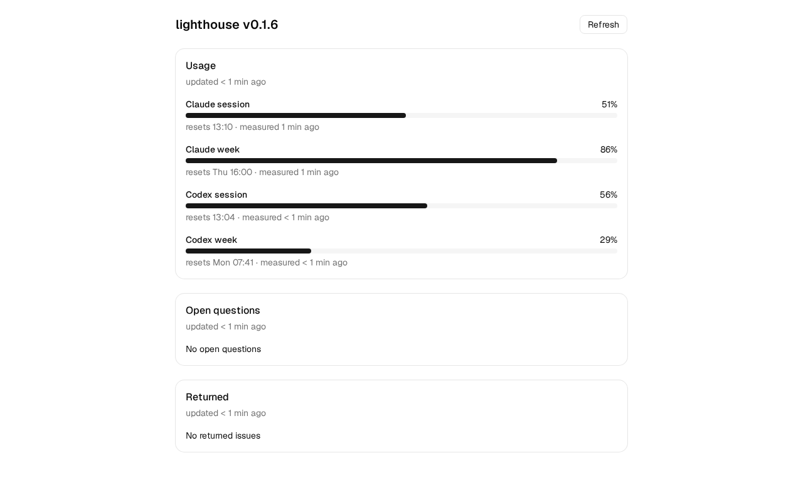

# lighthouse

Agentic lighthouse: the development chain from issue to green pull request, built as one Go binary with a web UI. It runs the controller, hooks, test gate, adversarial review, handoff and usage-window logic that today live as shell, Python and skills in a personal repository. It starts as the author's own tooling (a home server, one repository, GitHub). A second user, a developer with a laptop and a local server, comes next, so nothing in the code may depend on the author's paths, host or board. It can connect to an SDP tenant and do work inside it, but it does not need to run on SDP itself.

## Status

Usable without the controller: `lighthouse init` installs the skill and hook packages into your repository, with worktrees, a test gate before every commit, PR bodies with evidence and, with `codex`, adversarial reviews. Start with [Getting started](docs/getting-started.md). The maps at [corneeldh.github.io/lighthouse](https://corneeldh.github.io/lighthouse/) show the chain from issue to close and what each pack adds. The server, `lighthouse serve`, is in early development. Roadmap: the milestones of this repository.

## Design

The scope and roadmap: [lighthouse-scope-design](https://github.com/CorneeldH/personal_ai_agent/blob/main/docs/developer/planning/specs/2026-10-09-lighthouse-scope-design.md) (in Dutch).

## Usage window

`lighthouse usage refresh` and `lighthouse usage tick` measure the Claude usage windows, and `lighthouse usage codex` prints the Codex windows as JSON: [usage-venster](docs/usage-venster.md) (in Dutch).

## Dispatcher tick

`lighthouse tick` is one dispatcher pass, started by a timer: it takes `tick.lock`, checks the GitHub token and the `[dispatch]` repos of `host.toml`, and skips loudly each repo that cannot be served. It does not start runs yet: [tick](docs/tick.md) (in Dutch).

## Running the server

`lighthouse serve` starts the API and web UI on `127.0.0.1:8127`. Install it as a systemd user service: [install](docs/install.md).

The page shows the Claude and Codex usage windows, the open questions and the returned issues of one GitHub repository.

## Contributing

Bugs and questions go in an issue; pull requests need a signed [CLA](CLA.md). See
[CONTRIBUTING.md](CONTRIBUTING.md). Report a vulnerability privately, as described in
[SECURITY.md](SECURITY.md).

## License

[FSL-1.1-ALv2](LICENSE) — the Functional Source License with an Apache-2.0 future
license. Source-available, not OSI open source.

In short: read it, run it, modify it, self-host it, use it inside your own
organisation, teach and research with it. What you may not do is a **Competing
Use** — making it available to others in a commercial product or service that
substitutes for this one or offers substantially similar functionality. Every
release drops to plain [Apache-2.0](http://www.apache.org/licenses/LICENSE-2.0)
two years after it is published.

Want to do something the license does not permit? Ask — a commercial license is
available.
