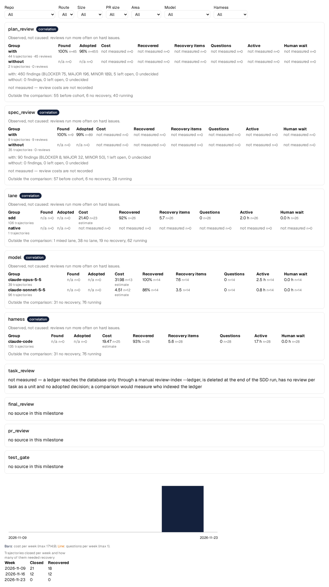

# Telemetry: het tabblad

Het tabblad *Telemetry* van `lighthouse serve` (`#telemetry`) laat per onderdeel van de keten zien
wat de telemetrie in `lighthouse.db` erover zegt: helpt een planreview, wat kost een traject, hoe
vaak moest werk na de merge hersteld worden. Het tabblad leest alleen de database, via een
readonly-verbinding; het leest geen forge en schrijft niets. De UI-teksten zijn Engels, zoals de
rest van de UI.

## De vier delen

Bovenaan staat een filterbalk (repo, route, plangrootte, PR-grootte, gebied, model, harness). Het
volle filter geldt voor Components en Trajectories; Timeline en Coverage nemen alleen de repo.

- **Components.** Eén vergelijkingsblok per onderdeel: `plan_review` en `spec_review` (met en
  zonder review), `lane` (`sdd` tegen `native`), `model` en `harness` (een groep per waarde). Per
  groep het aantal trajecten (in een reviewblok ook het aantal reviews), en: *Found* (aandeel
  reviews met minstens één bevinding), *Adopted* (overgenomen bevindingen van die met een besluit),
  *Cost* (mediaan van de trajectkosten, met `cost_kind`), *Recovered* (aandeel hersteld),
  *Recovery items* (gemiddeld aantal herstelacties), *Questions* (mediaan, alleen over trajecten
  met een run of sessie), *Active* en *Human wait* (mediaan in uren; de API levert seconden).
  Found en Adopted gelden alleen in een reviewblok; elders staan ze als *n/a*. Kosten en afloop
  tellen alleen over afgeronde trajecten: minstens één herstelmeting en geen met een open venster.
  Onder een reviewblok staat per groep het aantal bevindingen met de verdeling naar ernst, en
  hoeveel er open zijn gelaten (`left_open`) of nog geen besluit hebben (`undecided`).

  Elk vergelijkingsblok draagt een label: *Observed, not caused* (correlatie: de groepen zijn niet
  door lighthouse ingedeeld) of *Assigned by lighthouse* (elke groep is zuiver ingedeeld en
  minstens één is een `variant:`). De reviewblokken zeggen onder de tabel dat de reviewkosten niet
  gemeten zijn. Onder het blok staat hoeveel trajecten buiten de vergelijking vallen en waarom,
  voor zover het blok dat telt: buiten het cohort bij de reviewblokken, geen of gemengde lane bij
  `lane`, en lopend of zonder herstelmeting bij elk blok. Trajecten zonder model of met meer dan
  één harness staan in geen blok en ook niet in die regel; Coverage telt ze (`no_model`,
  `harness_mixed`). `task_review`, `final_review`, `pr_review` en `test_gate` hebben (nog) geen
  bron: zij staan er zonder label, alleen met hun reden.
- **Timeline.** Per ISO-week de kosten (staven) en de mensvragen (lijn), en daaronder een tabel met
  per week de afgeronde trajecten en hoeveel daarvan hersteld moesten worden. Een week vóór de
  eerste meting van een reeks is *not measured*, niet 0. De kosten vallen in de week van
  `usage.recorded_at`: de week waarin `telemetry collect` ze vastlegde, niet de week waarin het werk
  gebeurde. Een eerste `collect` over oude transcripten zet dus alle eerdere kosten in één week; dat
  is een bekende beperking.
- **Trajectories.** Alle trajecten, sorteerbaar op repo, issue, grootte, kosten en herstel, en te
  filteren op onderdeel. Herstel staat als *window open*, *recovered*, *no recovery needed* of
  *not measured* (geen herstelmeting). Een regel opent het detail (`#telemetry/trajectory/<id>`):
  runs en sessies met tokens en kosten per model, reviews met hun bevindingen, *Other findings*
  (bevindingen zonder reviewrun, zoals een SDD-ledger), herstelmetingen, gebeurtenissen en de tijd
  per oorzaak in uren. Van een bevinding staan alleen onderdeel, sleutel, ernst, besluit
  (*undecided* zonder besluit) en recordpad.
- **Coverage.** Elk gat in de meting als aantal met reden: sessies en reviewrecords zonder traject,
  trajecten vóór het cohort van een review, zonder inzet, kosten, route, gebied of PR-grootte,
  buiten de afloop (lopend of zonder herstelmeting) of buiten de lane-, model- of
  harnessvergelijking, en wat helemaal niet gemeten wordt.

## Wat *not measured* betekent

Een maat zonder waarde heet *not measured*, nooit 0: er is geen bron, of geen enkel traject in de
groep levert de waarde. De reden staat erbij (als tooltip in een cel, als tekst in Coverage). Een
maat over minder dan vijf eenheden staat grijs met *too few* en de eenheid: *trajectories*, of
*reviews* bij Found en *decided findings* bij Adopted. Vast *not measured*
zijn:

- de **reviewkosten**: een review legt zijn tokens niet apart vast, dus wat een plan- of
  specreview kost is niet te scheiden van de rest van het traject (`review costs: not recorded`);
- `task_review`: een SDD-ledger komt alleen met een handmatige `review-index --ledger` in de
  database en heeft geen besluit per bevinding;
- `final_review`, `pr_review` en `test_gate`: geen bron in deze milestone;
- Codex en OpenCode als harness: geen bron tot Explore/exploit.

## Wat het tabblad vult

Drie opdrachten schrijven wat het tabblad leest; geen ervan draait vanuit het tabblad.

- **`lighthouse telemetry collect`** leest de Claude Code-transcripten van de repo: inzet
  (`setups`: model, harness, lane), tokens en kosten (`usage`), sessies en hun vragen. De
  SessionStart-hook `telemetry-collect-check` start hem per sessie. Zie
  [`install.md`](install.md), *Inzet, kosten en tokens*.
- **`lighthouse review-index`** koppelt de plan- en specreviewrecords aan hun traject: één
  `review_runs`-rij per afgerond record en de bevindingen in `findings`. Zie
  [`review-index.md`](review-index.md).
- **`lighthouse measure-recovery --repo-dir <pad>`** meet per gemergde PR het herstel na de merge
  (`recoveries`, `recovery_items`) en legt de kenmerken van het traject vast: route (uit het
  triagecomment), gebied (uit het gebiedslabel) en PR-grootte (coderegels). Een traject zonder
  triagemarker kost bij elke run twee forge-lezingen en een `traits #<issue>:`-regel, tot de
  marker er is. Een gebied zoekt hij alleen met `[labels] area_prefix`. Wat de forge niet kon
  leveren (bijvoorbeeld een mislukte lezing van de comments) blijft leeg tot een volgende run. Zie
  [`install.md`](install.md), *Herstel na merge*.

Een database die nog niet gemigreerd is (zonder `review_runs` of een andere tabel) geeft geen
fout: Coverage meldt *database not migrated* met de ontbrekende tabellen.

## Endpoints

Het tabblad leest vijf endpoints. De filterparameters zijn `repo`, `route`, `size`, `pr_size`,
`area`, `model` en `harness`:

- `GET /api/telemetry/components` (alle filterparameters) — de vergelijkingsblokken, met `label`,
  `label_note` en per maat `value`, `n` en `reason`;
- `GET /api/telemetry/timeline?repo=` — de weken en markeringen;
- `GET /api/telemetry/trajectories` (alle filterparameters plus `component`) — de trajectenlijst;
- `GET /api/telemetry/trajectories/{id}` — het detail van één traject;
- `GET /api/telemetry/coverage?repo=` — de dekkingsregels.

Een screenshot van het tabblad maak je met
`cd web && node e2e/screenshot.mjs <url> <bestand> telemetry`.
